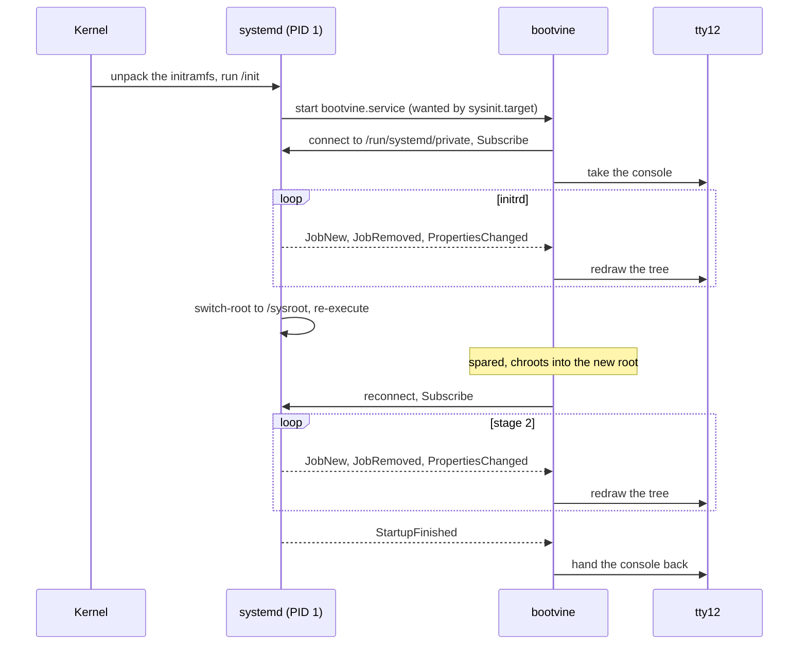
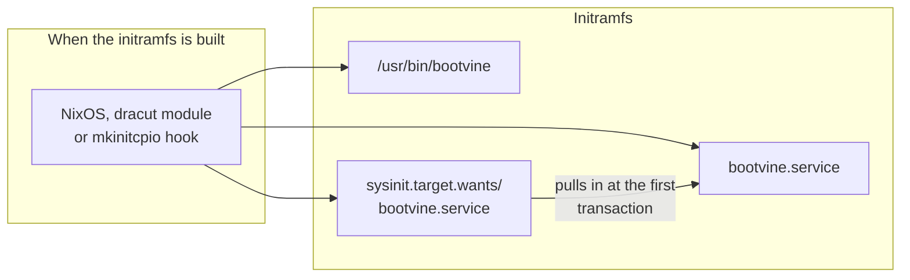
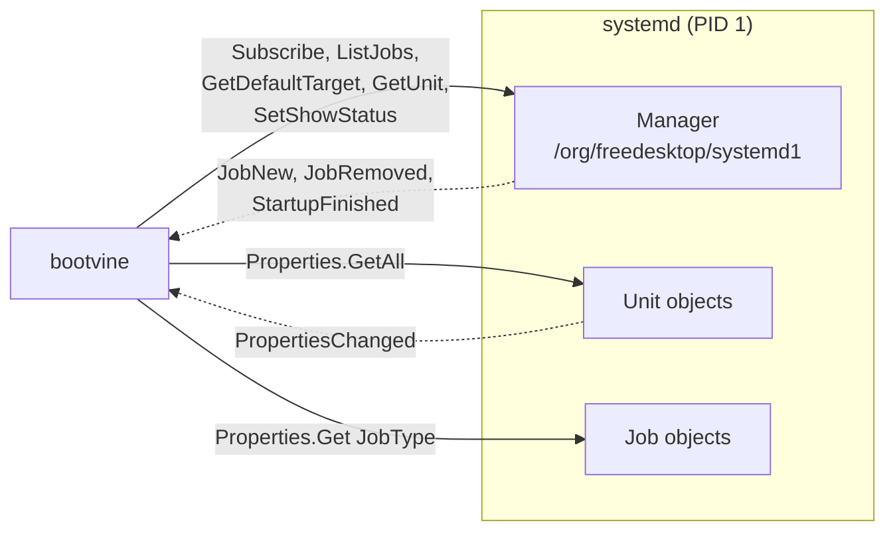
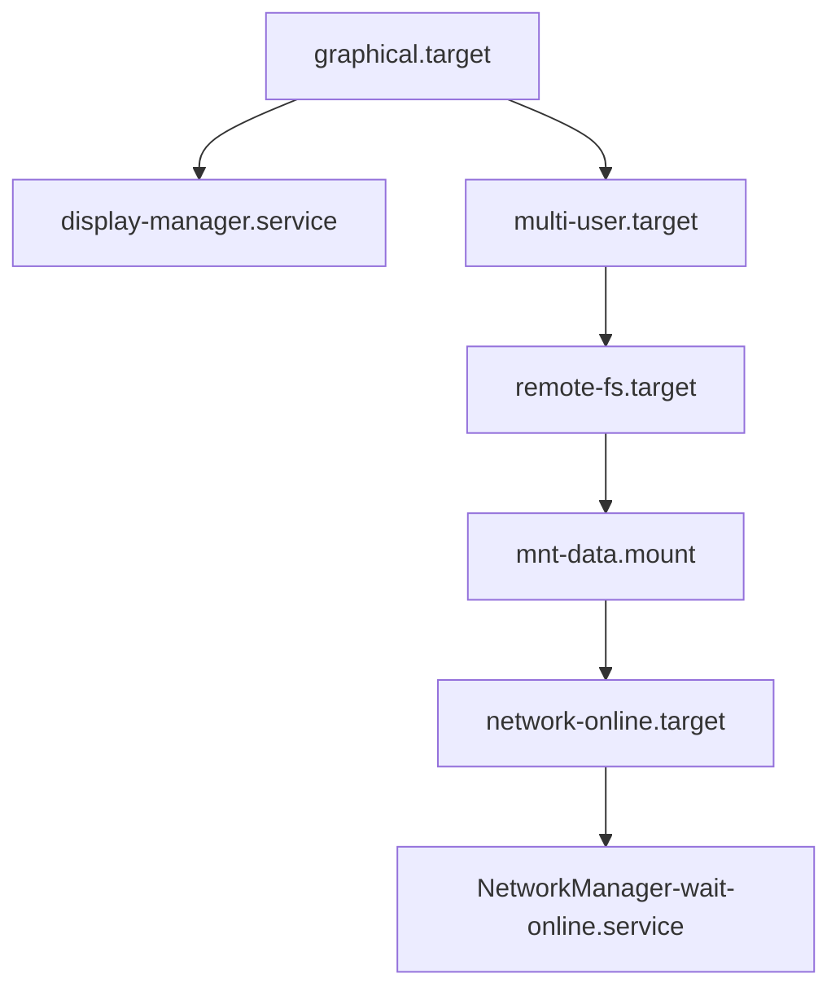
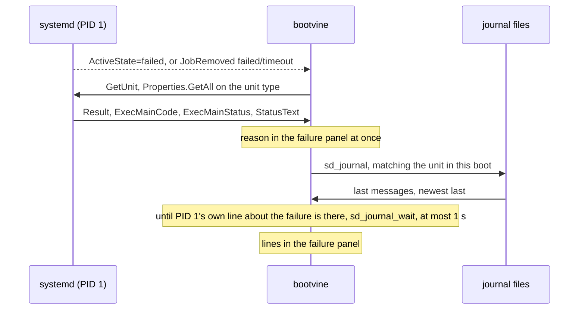
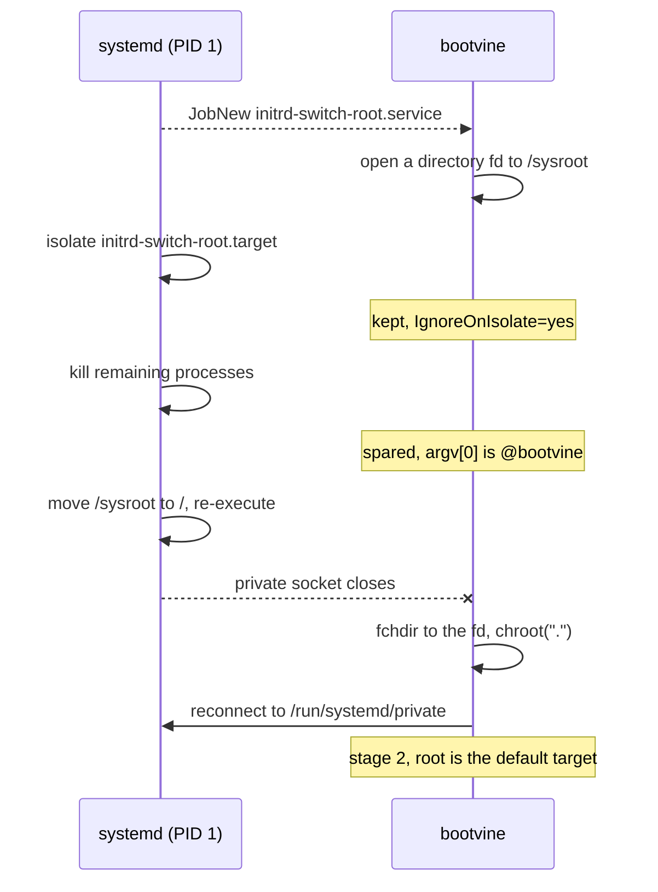

# Architecture

How bootvine follows a boot and a shutdown, and what it changes on the console
while it does. None of this is needed to install or configure it.

## Requirements

- **systemd ≥ 246 as PID 1.** bootvine reads the jobs and units from the
  service manager over D-Bus.
- **[libdbus](https://www.freedesktop.org/wiki/Software/dbus/).** It talks to
  PID 1 over systemd's private socket, which
  [zbus](https://github.com/dbus2/zbus) cannot use; see
  [systemd's private socket](#systemds-private-socket).
- **libsystemd.** It reads the last journal lines of a failed unit; see
  [failures](#failures).
- **A virtual terminal.** It draws on `tty12` and switches the console to it.

## Overview

## Starting in the initrd

The initrd is a small root file system that the kernel unpacks into memory and
runs before the real root is mounted. When it runs systemd, its `/init` is
systemd as PID 1, with the same units, targets and D-Bus API as on the real
root. bootvine hooks into that systemd rather than into the kernel.

1. **The image.** The initramfs generator copies the binary,
   `bootvine.service` and `/etc/bootvine.toml` into the image and enables the
   unit there, which links it into `sysinit.target.wants`.
2. **The first transaction.** systemd in the initrd starts `initrd.target`,
   which pulls in `sysinit.target` and with it `bootvine.service`.
3. **No waiting.** `DefaultDependencies=no` drops the implicit
   `After=sysinit.target basic.target`, so bootvine is not ordered after
   anything and starts in parallel with udev and the first mounts, about a
   second after the kernel.
4. **Knowing where it is.** `/etc/initrd-release` exists only in an initrd, so
   its presence tells bootvine it is in the initrd stage.

Without a systemd initrd, the same unit is enabled in the real root and starts
in stage 2 instead.

## What systemd exposes

PID 1 publishes its state on D-Bus under `org.freedesktop.systemd1`. In the
initrd there is no D-Bus daemon yet, so bootvine connects straight to PID 1 on
the private socket `/run/systemd/private`, which systemd listens on from the
moment it starts. Where that socket is not available, it falls back to the
system bus.

On connecting, bootvine:

1. calls `Subscribe`, without which PID 1 sends no signals;
2. calls `ListJobs` for the jobs already queued, since some were queued before
   it started;
3. calls `GetDefaultTarget` for the root of the tree, such as
   `initrd.target` in the initrd and `graphical.target` in stage 2;
4. reads `FinishTimestampMonotonic`, which stays 0 until the boot is finished.

From then on it follows the signals:

| Signal | Carries | Used for |
| --- | --- | --- |
| `JobNew` | job id, job path, unit name | a row in the tree |
| `JobRemoved` | job id, unit name, result | the row finishes as done, failed or skipped |
| `PropertiesChanged` on a unit | `ActiveState` and its timestamps | running since, and the timeline |
| `StartupFinished` | | the boot reached its default target |

For each unit it meets, `GetUnit` and `Properties.GetAll` give its
`Description`, its `After=` and `Before=` orderings and its timeouts.

### From orderings to a tree

A unit waits on the units in its `After=` that still have a pending job; when
stopping, on the units in its `Before=`. bootvine nests each unit under the one
waiting on it, starting from the default target.

Here `graphical.target` is `After=multi-user.target`, `remote-fs.target` is
`After=` the network mount, the mount is `After=network-online.target`, and so
on down to the unit that is actually running. A target is ordered after the
units it wants, so targets fill the upper levels.

### Timestamps

systemd's `…TimestampMonotonic` properties count microseconds of
`CLOCK_MONOTONIC`, which starts with the kernel. bootvine reads the same
clock, so the times it shows are measured from the kernel start, even for
units that ran before bootvine did.

### Failures

`JobRemoved` says how a job ended: `failed`, `timeout` or `dependency`. Like
systemd's own `[FAILED]`, `[ TIME ]` and `[DEPEND]`, bootvine tells them
apart: a unit that failed only because a dependency did is shown dimmed in the
tree and left out of the failure panel, so the panel points at the unit that
actually broke. A unit whose `ActiveState` turns `failed` without a failed job,
such as a service crashing after it started, counts as failed too.

For a unit that broke or timed out, bootvine collects the cause once:

- **The reason** comes from the unit type's `Result` (`exit-code`, `signal`,
  `timeout`, `start-limit-hit`, `oom-kill`, …), with the exit status or signal
  of the main process, and the service's `StatusText` when it set one. These
  are read when the unit fails, since they change at that moment.
- **Timing**: the journal lines are read without holding up the bus: the failure and
  its reason reach the screen first. PID 1 logs its own "Failed with result…"
  or "Failed to start…" line once the unit's process has exited, so bootvine
  takes that line's presence as the sign that the unit's own lines are in, and
  until then waits for the journal to grow with `sd_journal_wait`.
- **The journal lines** match the unit the same way `journalctl -u` does
  (`_SYSTEMD_UNIT=` or `UNIT=`, in the current boot), without PID 1's own
  "Starting…", "Failed with result…" and "Failed to start…" lines, which the
  reason already covers. In the initrd they come from `/run/log/journal`. The
  journal is opened without `SD_JOURNAL_LOCAL_ONLY`: libsystemd caches the
  initrd's machine ID, which would hide the real root's files after the
  switch, and the boot ID match already keeps other machines out.
- **libsystemd** is linked rather than calling `journalctl`, since dracut,
  mkinitcpio and the NixOS initrd builder copy the libraries a binary links
  into the initramfs along with it, while `journalctl` may not be there.

## Surviving the switch to the real root

At the end of the initrd, systemd mounts the real root at `/sysroot`, isolates
`initrd-switch-root.target` and runs `initrd-switch-root.service`, which makes
PID 1 kill the remaining processes, move `/sysroot` to `/` and re-execute
itself from the real root.

Three things keep bootvine alive across it:

- **A process name starting with `@`.** `ExecStart=@/usr/bin/bootvine
  @bootvine` sets `argv[0]` to `@bootvine`, and switch-root spares processes
  whose name starts with `@`.
- **`IgnoreOnIsolate=yes`**, so isolating `initrd-switch-root.target` does
  not stop the unit.
- **A file descriptor to the new root.** After the switch, `/sysroot` no
  longer exists and bootvine's own root is still the old initramfs. A
  directory opened as soon as the switch-root job is queued lets it `chroot`
  into the real root, where `/run/systemd/private` is the re-executed PID 1.

When the connection drops, bootvine moves the initrd into the finished stages
and reconnects for up to a minute.

## Lifecycle

### Boot

1. **Start**, in the initrd or in stage 2; see
   [starting in the initrd](#starting-in-the-initrd).
2. **Switch to the real root**; see
   [surviving the switch](#surviving-the-switch-to-the-real-root).
3. **Stage 2.** The tree shows the jobs still pending under the default
   target.
4. **Handover.** bootvine hands the console back once the default target is
   reached and the final frame has stayed for `keep-final-frame-for`. When a
   display manager is starting, it waits instead for the display manager to
   switch to its own terminal, up to `wait-for-display-manager`.

If it starts after the boot has already finished, it exits without touching
the console.

### Shutdown

`shutdown.target` conflicts with `bootvine.service` and wants
`bootvine-shutdown.service`, which runs `bootvine --shutdown`. Its root is the
target being brought up, such as `poweroff.target` or `reboot.target`. It
shows the units being stopped, nested under the units that have to stop first,
until PID 1 hands over to `systemd-shutdown` and the connection closes.

systemd runs every stop job before a start job, so other units start stopping
while bootvine is still starting, and systemd prints their status lines on the
terminal in front. The unit therefore keeps that window short:

- it is not ordered after the display manager, so it starts with the first
  stop jobs instead of after the display manager has stopped;
- its `ExecStartPre=bootvine take-shutdown-console` switches to `tty12` and
  silences systemd's status output before the viewer even starts. Any status
  line printed before that lands on `tty12`, where the first frame covers it.

If the display manager switches terminals while it stops, it is no longer
running, so bootvine takes the console back.

### Emergency and rescue shells

`bootvine.service` also conflicts with `emergency.service` and
`rescue.service`, so systemd stops bootvine before their shell starts. A
failed unit in the initrd, such as a LUKS unlock that gave up, never reaches
the switch to the real root, so bootvine would otherwise keep `tty12` in
front while the shell writes over the tree on `/dev/console`, which is that
same terminal.

When it is stopped and one of these shells has a start job queued, bootvine
first reads the bus until it has seen that start job. systemd sends the
signals of earlier failures before it, so every failure that led to the shell
is then known. It also waits for their journal lines, at most 1.2 s in all.
Then it clears `tty12` and prints a summary at the top: the header, the
stages, the failure panel and the tally. It leaves `tty12` in front with the cursor
below the summary, so the shell starts underneath it and the reason for the
failure stays on screen. Any other stop switches back to the earlier terminal
as before.

## The console

While it runs, bootvine:

- **brings `tty12` to the foreground**, and takes it back if something else
  switches away during the boot. When another terminal comes to the front it
  first asks systemd whether `display-manager.service` is running: a display
  manager can only switch terminals once it runs, so the answer tells a
  display manager's switch apart from any other, whichever of the two events
  bootvine sees first;
- **quiets the kernel console** by setting the console log level in
  `/proc/sys/kernel/printk` to 1, so only emergency messages reach the
  screen, and sets it again if something raises it;
- **silences systemd's status output** with the manager's `SetShowStatus`
  call;
- **repaints every cell when another program writes to `tty12`**, such as PID
  1 while it re-executes during a root switch, since drawing only the cells
  that changed would leave that writing on screen. `/dev/vcs12` signals
  `POLLPRI` on every change to the terminal; after drawing, bootvine reads it
  once to clear the change its own write caused, so the next signal means
  another program wrote.

It restores the log level when it hands the console back. It keeps running
without touching the console until the boot finishes and only then restores the
status output, so jobs still running cannot write over a display manager that
started before them. This holds for a handover and for an error. Pressing a
[quit key](guide.md#leaving-the-tree) or stopping the service restores the
output at once, so a stuck boot stays visible; status lines can then reach a
display manager that starts before the boot finishes. Kernel messages from before it starts are already on screen; see
[early kernel messages](configuration.md#early-kernel-messages).

### Resuming from hibernation

The kernel freezes all processes before it loads a hibernated image, so
bootvine cannot draw during the load. A drop-in on
`systemd-hibernate-resume.service` runs `bootvine open-resume-console` first,
which:

- creates `/run/bootvine/resume-console-open`, so the running bootvine stops
  drawing, stops resetting the log level and stops taking `tty12` back;
- raises the console log level to 7, so the kernel's `pr_info` progress lines
  reach the screen, and hides their timestamps;
- draws a band across the middle of `tty12`, limits scrolling to the two rows
  inside it, and sets the colour and cursor there. The kernel console writes at
  the cursor in the terminal's current colour, always from column 0, so it
  stays inside the band without knowing about it.

If an image is restored, none of this needs undoing: the boot kernel's memory
is replaced, and the restored system keeps its own log level and terminals. If
not, `bootvine close-resume-console` runs as `ExecStopPost`, restoring what
the marker recorded, the colour and the scrolling, and bootvine repaints.

### Passphrase prompts

bootvine acts as a systemd
[password agent](https://systemd.io/PASSWORD_AGENTS/): it watches
`/run/systemd/ask-password` and answers requests, such as a
[LUKS](https://gitlab.com/cryptsetup/cryptsetup) unlock, in a
popup over the tree. If another agent's prompt is already showing when it
starts, it stays behind it and comes forward once the prompt is answered.

## The units

| Unit | Wanted by | Notable settings |
| --- | --- | --- |
| `bootvine.service` | `sysinit.target` | `DefaultDependencies=no`, `IgnoreOnIsolate=yes`, `Before=display-manager.service`, `Conflicts=shutdown.target emergency.service rescue.service`, process name `@bootvine` |
| `bootvine-shutdown.service` | `shutdown.target` | `After=bootvine.service` |

Both draw on `/dev/tty12` with `TTYReset=yes` and log to the journal.

## One event loop

Everything runs on one thread, shaped as an
[Elm application](https://guide.elm-lang.org/architecture/):

- **`Model`** holds the boot, the password prompt, who holds the console and
  where the handover stands.
- **`update(model, message, now)`** applies one `Message` and returns the
  `Command`s to carry out. It reads no files, devices or clocks; the time
  arrives with it.
- **`view(model)`** renders the frame, the shell summary or nothing.
- **`subscriptions(model)`** lists the `Subscription`s the model needs. After
  every update the loop compares that list with what runs, starts what is new
  and drops what is no longer wanted.

A runtime carries out commands and turns subscriptions into streams of
messages. The live runtime does it with syscalls and the bus; the scripted
demos have their own runtime that plays a script through the same messages.
A command's result comes back as a message, such as `AskShellStarting`
answered by `ShellQueryAnswered`.

### Four crates

| Crate | Holds | Depends on |
| --- | --- | --- |
| `bootvine-screen` | the model, the view and the screen application: `Model`, `Message`, `Command`, `Subscription`, `update`, `view`, `subscriptions`; settings parsing; the `ServiceManager` trait | ratatui's core and widgets, serde, petgraph, `futures-core` and other pure libraries |
| `bootvine-systemd-link` | `SystemdLink`: the job feed over the private socket, journal lines, the password agent, status output and the systemd vocabulary | `bootvine-screen`, dbus, libsystemd, tokio, rustix |
| `bootvine-openrc-link` | `OpenrcLink`: service state from `/run/openrc`, the dependency cache and the OpenRC vocabulary | `bootvine-screen`, inotify, rustix |
| `bootvine` | the live runtime, the console (virtual terminal, `/dev/vcs12`, printk, font, resume console), the screen loop, install and `main` | the screen crate and whichever link crates its features enable |

Each link crate exports its link struct, its error type and its vocabulary;
everything else is private, and `#![deny(unreachable_pub)]` keeps it so.

The compiler keeps this shape:

- **No effects in the screen.** `bootvine-screen` does not depend on tokio,
  rustix, dbus, libsystemd, crossterm or futures, so it cannot call them.
  `futures-core` only defines the `Stream` trait. The parts of std that touch
  the system (`std::fs`, `std::env`, `std::process`, path metadata such as
  `Path::exists`, the wall clock) are caught by the
  `screen-crate-without-effects` ast-grep rule. In its `lib.rs`,
  `#![forbid(unsafe_code)]` keeps out raw system calls, and printing or
  exiting is a lint error.
- **The Elm signatures.** The screen loop in `bootvine` calls `update`,
  `view` and `subscriptions` with fixed types, so changing one breaks the
  build.
- **Plain data.** `Command` must be `Clone + Eq + Debug` and `Subscription`
  also `Hash`, checked at compile time; closures and trait objects cannot
  meet that.

### Service managers

One trait, `ServiceManager` in `bootvine-screen`, is everything the runtime
asks of an init system. Each link crate implements it directly:

- **Streams** for what flows in: boot changes, password requests, console
  prompts by other programs.
- **Futures** for one-shot requests with an outcome: whether the boot is
  still running, answering a password, whether a shell or the display manager
  is starting, and keeping the init system's own status output quiet while the
  screen runs.
- **Plain calls** for what is known at once: the vocabulary, the starting
  phase, whether a prompt shows right now.

Errors are the link's own typed `Failure`; the boot stream carries
`WatchFailure`, the screen's message for a lost feed. Nothing crosses the
boundary boxed: the screen loop boxes once, when it stores a subscription's
stream or a command's future next to the others.

Commands that ask the init system something return `Performed::Later` with a
future; the loop polls those beside the subscriptions and feeds their messages
back to `update`. Console commands stay `Performed::Now`, so their effects keep
their order.

`bootvine` builds with the `systemd` feature by default and `openrc` on
request. At start it detects the running manager (`/run/systemd/system`, then
`/run/openrc/softlevel`) among the compiled-in links and runs the same generic
code with it. A build for Alpine or Gentoo leaves out `systemd` and so links
neither libdbus nor libsystemd.

#### What OpenRC gives

OpenRC keeps each service's state as a link in `/run/openrc/starting`,
`started`, `stopping`, `inactive` or `failed`, the current runlevel in
`softlevel`, and `rc.starting` while a runlevel change runs. inotify on those
directories drives the feed; each change rereads them and diffs against the
previous reading:

- a service entering `starting` queues a job, and `started` or `failed`
  finishes it;
- `sysinit`, `boot` and `default` are targets whose dependencies are their
  members in `/etc/runlevels` plus the runlevel before; `default` is the
  root;
- the boot finishes once `default` settles with nothing starting.

Orderings come from the dependency cache `/run/openrc/deptree` (`need`, `use`,
`want` and `after`). OpenRC has no journal, so failures carry no reason; no
password agent, so bootvine answers no prompts; and no manager in the initrd.
`dmcrypt` asks for LUKS passphrases on the console itself, so while it starts
the screen steps aside to the previous virtual terminal and comes back
afterwards.

Subscriptions wait on the kernel or on the init system rather than on timers:

| Subscription | Present | Woken by |
| --- | --- | --- |
| Boot feed | always | the bus socket becoming readable, or a failed unit's journal read finishing |
| Password requests | system scope | inotify on `/run/systemd/ask-password` |
| Console prompts | system scope | inotify on `/run/openrc` (OpenRC); never with systemd |
| Abandonment of the shown prompt | while a prompt shows | the asker's pidfd becoming readable, or a timer until its `NotAfter` |
| Terminal switches | always | `POLLPRI` on `/sys/class/tty/tty0/active` |
| Console writes | always | `POLLPRI` on `/dev/vcs12` |
| Resume marker | system scope | inotify on `/run/bootvine` |
| Frame ticks | while something animates | a 16 ms timer, for spinners and running times |
| Deadline | while handing over or settling for a shell | a one-shot timer |

The console log level and font are read after each batch of boot changes,
since units such as `systemd-sysctl` and `systemd-vconsole-setup` change them.
Timers remain only where time itself is the point: frame ticks, deadlines, call
timeouts and the retry every 100 ms while PID 1 re-executes. Without inotify,
password requests fall back to a check every 100 ms.

## systemd's private socket

- zbus rejects it, because PID 1 sends under its well-known name rather than a
  unique one. libdbus works.
- libdbus sends its authentication handshake together with the first message,
  which systemd leaves unread, so a no-reply ping goes out right after
  connecting.
